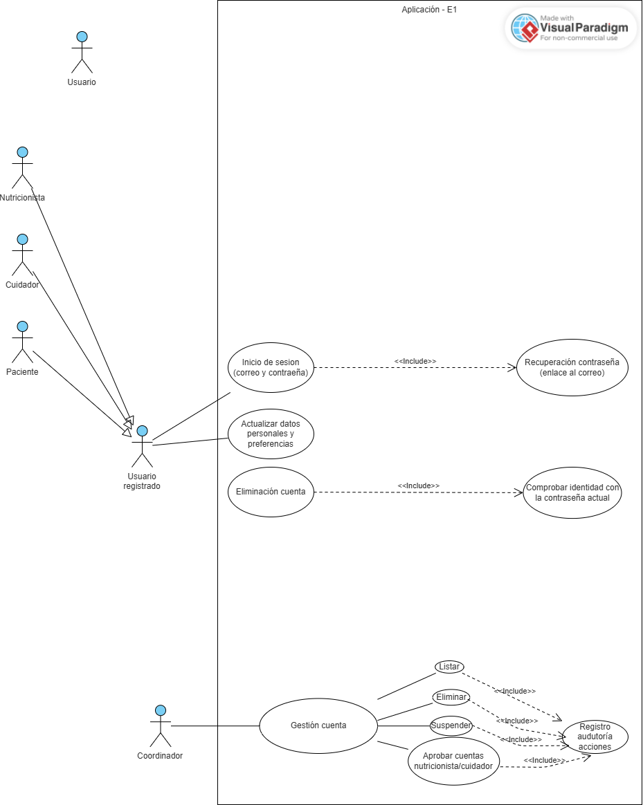
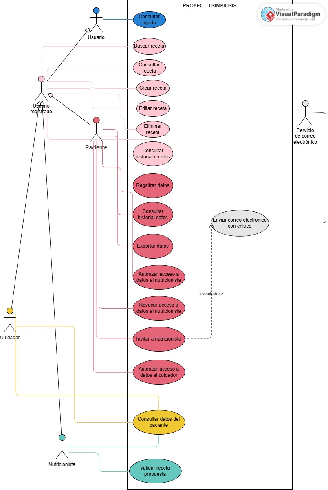

# Modelo de casos de uso de Proyecto Simbiosis

| Versión | Fecha | Estado |
| --- | --- | --- |
| 1.6 | 11/10/2026 | Revisado |
| 2.0 | 15/10/2026 | Revisado |

**Iteración de referencia:** E2. Este documento incorpora los resultados y la segunda vista del modelo (salud y recetas), acumulándolos sobre la primera vista revisada de E1.

**Plantilla base:** [Plantilla del modelo de casos de uso](plantilla-modelo-casos-de-uso.md). La plantilla se conserva sin cumplimentar. Los resultados del proyecto se incorporan a este documento.

Los diagramas representan distintas vistas del mismo modelo. Los nombres de los actores y los identificadores de los casos de uso se mantienen entre iteraciones.

## 1 Alcance del modelo

La vista de E1 representa el acceso local, la gestión básica de cuentas y la ayuda seleccionada en el apartado 4 del [plan de E1](../planificacion/plan-iteracion-e1.md). Cubre parte de UR-01, UR-02, UR-03, UR-12 y UR-13.

Incluye el registro local y sus condiciones por perfil, la verificación del correo, el inicio de sesión y el restablecimiento de la contraseña. Incluye también la actualización del perfil, la eliminación de la cuenta propia, la autorización de una relación de cuidado, la gestión básica de cuentas por el coordinador, la ayuda contextual y la bienvenida.

La gestión básica de cuentas se representa mediante cuatro objetivos del coordinador: aprobar cuentas de cuidador y nutricionista, suspender cuentas, eliminar cuentas y consultar el listado de cuentas. Las operaciones de aprobación, suspensión y eliminación incluyen el registro de la acción en el historial de auditoría.

La verificación del correo, la aprobación de una cuenta por el coordinador y la autorización de una relación de cuidado son condiciones distintas. Verificar el correo no sustituye las otras dos condiciones.

El modelo no completa los módulos de Gestión de usuarios y Guía interactiva. Quedan pendientes las siguientes funciones:

- El registro, el acceso y la vinculación con Google.
- El uso del alias en los espacios públicos. E1 establece el alias durante el registro.
- La ayuda sobre las funciones todavía no representadas, el progreso entre sesiones, la multimedia y la búsqueda de temas.
- El bloqueo temporal y la expulsión por infracciones.
- El fin de las relaciones de cuidado y la gestión automática de cuentas de cuidador sin pacientes.
- Las funciones de salud, recetas, foro, publicaciones y moderación de contenidos.

Los aplazamientos conservan los requisitos del proyecto. El modelo recoge las funciones seleccionadas para el trabajo de requisitos de E1, aunque algunas queden fuera de su prototipo.

### Ampliación del alcance en E2

La vista de E2 incorpora las funciones de salud y recetas seleccionadas en el apartado 4 del [plan de E2](../planificacion/plan-iteracion-e2.md). Cubre parte de UR-01, UR-05, UR-06, UR-08 y la ampliación de temas de ayuda de UR-12:

- **Datos de salud e historial (UR-05):** Introducción manual de datos fisiológicos (peso, altura, presión arterial sistólica y diastólica, frecuencia cardíaca, temperatura corporal) y de resultados de análisis de laboratorio con unidades configurables (glucosa, colesterol y otros parámetros). Registro de notas de síntomas o estado diario (hasta 500 caracteres). Consulta del historial ordenado cronológicamente de más reciente a más antiguo, filtrado por tipo de dato y acceso a gráficas. Exportación de datos de salud en formatos PDF y CSV.
- **Acceso autorizado a datos de salud (UR-05):** Autorización y revocación expresa de acceso a nutricionistas específicos y verificados para consultar datos de salud. Invitación por correo electrónico a nutricionistas que aún no disponen de cuenta en la plataforma. Autorización expresa para que el cuidador acceda a los datos de salud compartidos por el paciente. Consulta de datos de salud del paciente por parte de cuidadores y nutricionistas debidamente autorizados.
- **Creación, gestión y validación de recetas (UR-06):** Creación de recetas mediante formulario con campos obligatorios, categorías y etiquetas, adjuntando imágenes o vídeos admitidos. Edición y eliminación con confirmación de recetas propias, y consulta del historial de recetas publicadas y propuestas. Propuesta de recetas por pacientes o cuidadores (en estado pendiente de validación). Validación profesional por nutricionistas aprobados y publicación con insignia distintiva. Publicación directa como validadas de recetas creadas por nutricionistas aprobados.
- **Búsqueda y consulta de recetas (UR-08):** Búsqueda por palabras clave, ingredientes y autor, exclusión de ingredientes y filtros avanzados combinados (tipo de comida, tiempo de preparación, nivel de dificultad, restricciones dietéticas). Filtrado por alergias e intolerancias alimentarias configuradas en el perfil de usuario. Ordenación por relevancia o fecha de publicación. Consulta del detalle de recetas. Requisito de registro e inicio de sesión para búsqueda avanzada y filtros basados en perfil.
- **Identidad pública y ayuda (UR-01 y UR-12):** Uso del alias como identidad visible en espacios públicos de recetas. Ampliación de la ayuda interactiva con temas dedicados a la búsqueda y publicación de recetas.

Tras E2, continúan aplazadas para iteraciones posteriores las siguientes funciones:

- Los recordatorios automáticos de datos fisiológicos y la propuesta profesional de frecuencia (FR-043, FR-044, FR-199, FR-200).
- La gestión de alertas críticas y umbrales clínicos (FR-051, FR-052, FR-202, FR-203, FR-217).
- La calculadora nutricional automática y las estadísticas completas de recetas (FR-064, FR-065).
- La ordenación por popularidad o calificación promedio, sugerencias automáticas de búsqueda y recomendaciones personalizadas (FR-097, FR-098, FR-100 a FR-102, FR-104 a FR-108).
- Las notificaciones internas de nuevas recetas y el historial personal de búsquedas (FR-109 a FR-111).
- Favoritas, listas personalizadas, lectura posterior, descarga, impresión, compartición en redes sociales y estadísticas de consulta (FR-112 a FR-118).
- Foro, consejos de vida saludable, reportes, moderación, valoraciones y comentarios (UR-04, UR-07, UR-09, UR-10, UR-11).
- Registro, acceso y vinculación con Google (FR-006, FR-018, FR-190, NFR-015).
- Sanciones, expulsión, fin de relaciones de cuidado y ciclo de vida de cuentas de cuidador sin pacientes (FR-186, FR-187, FR-208 a FR-210).
- Progreso entre sesiones, multimedia avanzada y búsqueda en la guía de ayuda (FR-178 a FR-180).

## 2 Actores

Un actor representa un rol externo que interactúa con Proyecto Simbiosis. Una misma persona puede desempeñar más de un rol.

| Nombre del actor | Rol que representa |
| --- | --- |
| Usuario | Persona que interactúa con la plataforma. Este rol general permite representar funciones que no exigen una sesión iniciada. |
| Usuario registrado | Persona que tiene una cuenta. La existencia de la cuenta no implica que haya iniciado sesión. |
| Paciente | Usuario registrado que puede autorizar una relación de cuidado solicitada para él. |
| Cuidador | Usuario registrado que solicita o mantiene relaciones de cuidado con pacientes. |
| Nutricionista | Usuario registrado con perfil profesional sujeto a la aprobación de su documentación. |
| Coordinador | Usuario registrado que consulta el listado de cuentas y aprueba, suspende o elimina cuentas dentro de sus permisos. |
| Servicio de correo electrónico | Sistema externo que presta el servicio de envío de mensajes de verificación y restablecimiento. |

**Generalizaciones.** Usuario registrado especializa a Usuario. Paciente, Cuidador, Nutricionista y Coordinador especializan a Usuario registrado. Cada actor especializado hereda la participación del actor general en sus casos de uso.

Usuario registrado se representa como actor abstracto para agrupar las funciones comunes de los perfiles. La generalización expresa roles, no una secuencia de registro o de inicio de sesión. Paciente y Cuidador no son roles excluyentes: FR-212 permite que una cuenta tenga ambos perfiles.

Cuidador y Nutricionista no tienen asociaciones exclusivas en esta vista. Participan mediante las funciones heredadas. Las condiciones de solicitud de esos perfiles se estudian dentro del registro. El Servicio de correo electrónico es un actor de apoyo y no pertenece a la jerarquía de usuarios.

El registro de auditoría forma parte del comportamiento del sistema. No requiere un actor adicional ni una interacción directa del Coordinador con UC-35.

**Participación de los actores en la vista de E2:**

En la segunda vista del modelo, los actores intervienen del siguiente modo:

- **Usuario:** Consulta la ayuda contextual y general del sistema (UC-09).
- **Usuario registrado:** Como actor general de las cuentas con sesión iniciada, asocia las operaciones de búsqueda y consulta de recetas (UC-25 y UC-26) y la gestión de recetas propias (UC-20 Crear receta, UC-21 Editar receta, UC-22 Eliminar receta y UC-23 Consultar historial recetas), heredadas por Paciente, Cuidador y Nutricionista.
- **Paciente:** Registra datos de salud propios (UC-12), consulta su historial (UC-13), exporta datos (UC-14), autoriza y revoca el acceso a nutricionistas (UC-15 y UC-16), invita a nutricionistas sin cuenta (UC-17) y autoriza el acceso a datos a su cuidador (UC-18).
- **Cuidador:** Consulta los datos de salud compartidos del paciente cuando dispone de autorización expresa (UC-19).
- **Nutricionista:** Consulta los datos de salud del paciente cuando dispone de autorización expresa (UC-19) y valida las recetas propuestas por pacientes o cuidadores (UC-24).
- **Servicio de correo electrónico:** Actúa como actor de apoyo externo enviando el correo con enlace de invitación para el registro de nuevos nutricionistas (UC-11).
- **Coordinador:** No participa en la vista de salud y recetas de E2, pero mantiene sus funciones de gestión de cuentas en el modelo acumulado.

## 3 Casos de uso

Los objetivos de esta tabla son resúmenes. Las descripciones detalladas quedan pendientes en el apartado 6.

| Identificador | Nombre | Objetivo | Participantes |
| --- | --- | --- | --- |
| UC-01 | Registrar cuenta | Solicitar una cuenta local con los datos y las condiciones del perfil elegido. | Principal: Usuario. Apoyo: Servicio de correo electrónico, mediante UC-11. |
| UC-02 | Verificar correo electrónico | Confirmar la dirección de correo como condición para completar el registro. | Principal: Usuario. |
| UC-03 | Iniciar sesión | Establecer una sesión mediante las credenciales de una cuenta cuyo estado permita el acceso. | Principal: Usuario registrado. |
| UC-04 | Restablecer contraseña | Recuperar el acceso mediante un enlace enviado al correo de la cuenta. | Principal: Usuario registrado. Apoyo: Servicio de correo electrónico, mediante UC-11. |
| UC-05 | Actualizar perfil | Modificar los datos personales y las preferencias de la cuenta propia. | Principal: Usuario registrado. |
| UC-06 | Eliminar cuenta propia | Eliminar la cuenta propia tras comprobar la identidad con la contraseña actual. | Principal: Usuario registrado. |
| UC-07 | Autorizar relación de cuidado | Dar autorización expresa para activar una relación de cuidado concreta. | Principal: Paciente. |
| UC-09 | Consultar ayuda | Consultar las instrucciones y los temas de ayuda de las funciones seleccionadas. | Principal: Usuario. |
| UC-10 | Recorrer bienvenida | Conocer las funciones básicas mediante el recorrido del primer acceso, con la posibilidad de omitirlo. | Principal: Usuario registrado. |
| UC-11 | Enviar correo electrónico | Enviar el mensaje que necesita el caso de uso que lo incluye. | Apoyo: Servicio de correo electrónico. No se asigna un actor principal independiente. |
| UC-12 | Registrar datos | Introducir manualmente variables fisiológicas, resultados de análisis de laboratorio o notas de síntomas. | Principal: Paciente. |
| UC-13 | Consultar historial datos | Consultar las mediciones y notas de salud propias ordenadas cronológicamente, con filtrado por tipo de dato y gráficas. | Principal: Paciente. |
| UC-14 | Exportar datos | Descargar el historial de datos fisiológicos y de salud propios en formatos PDF y CSV. | Principal: Paciente. |
| UC-15 | Autorizar acceso a datos al nutricionista | Conceder autorización expresa a un nutricionista verificado para consultar los datos de salud del paciente. | Principal: Paciente. |
| UC-16 | Revocar acceso a datos al nutricionista | Retirar en cualquier momento la autorización de acceso a datos de salud previamente concedida a un nutricionista. | Principal: Paciente. |
| UC-17 | Invitar a nutricionista | Solicitar el envío de un correo de invitación a un nutricionista que no dispone de cuenta para que se registre. | Principal: Paciente. Apoyo: Servicio de correo electrónico, mediante UC-11. |
| UC-18 | Autorizar acceso a datos al cuidador | Conceder autorización expresa al cuidador asociado para consultar los datos de salud que el paciente decida compartir. | Principal: Paciente. |
| UC-19 | Consultar datos del paciente | Consultar la información de salud de un paciente sobre la que se dispone de autorización expresa vigente. | Principal: Cuidador, Nutricionista. |
| UC-20 | Crear receta | Redactar y enviar una nueva receta con los campos obligatorios, categorías y etiquetas. | Principal: Usuario registrado. |
| UC-21 | Editar receta | Modificar una receta propia propuesta o publicada, manteniendo el registro de cambios. | Principal: Usuario registrado. |
| UC-22 | Eliminar receta | Dar de baja una receta propia previa confirmación para evitar borrados accidentales. | Principal: Usuario registrado. |
| UC-23 | Consultar historial recetas | Consultar el listado completo de las recetas propias publicadas o pendientes, con sus estados y visualizaciones. | Principal: Usuario registrado. |
| UC-24 | Validar receta propuesta | Revisar una receta propuesta por un paciente o cuidador y aprobar su publicación como receta validada. | Principal: Nutricionista. |
| UC-25 | Buscar receta | Buscar recetas mediante palabras clave, ingredientes y filtros avanzados (categorías, restricciones dietéticas y alergias del perfil). | Principal: Usuario registrado. |
| UC-26 | Consultar receta | Consultar el detalle completo de una receta seleccionada (ingredientes, preparación, autoría e insignias). | Principal: Usuario registrado. |
| UC-31 | Aprobar cuenta de cuidador o nutricionista | Aprobar una cuenta solicitada con perfil de cuidador o nutricionista, conforme a las condiciones del perfil. | Principal: Coordinador. |
| UC-32 | Suspender cuenta de usuario activa | Suspender una cuenta de usuario que se encuentra activa. | Principal: Coordinador. |
| UC-33 | Eliminar cuenta de usuario | Eliminar una cuenta de usuario y conservar el contenido publicado cuando corresponda a un cuidador. | Principal: Coordinador. |
| UC-34 | Consultar listado de cuentas de usuario | Consultar las cuentas y su información básica: nombre, correo, rol y estado. | Principal: Coordinador. |
| UC-35 | Registrar acción en el historial de auditoría | Registrar la fecha, la hora y la acción realizada al aprobar, suspender o eliminar una cuenta. | Sin participación directa de un actor. Comportamiento incluido en UC-31, UC-32 y UC-33. |

UC-03 se representa como una subfunción de apoyo. Tener una sesión válida es una condición previa de las funciones protegidas. Esto no implica ejecutar UC-03 cada vez que se realiza una de ellas.

UC-04 requiere una cuenta, pero no una sesión iniciada. UC-02 representa la acción de verificar el correo; recibir el mensaje de UC-11 no equivale a verificarlo.

UC-07 se aplica a cada relación de cuidado. Su objetivo se distingue de la aprobación de la cuenta de cuidador que realiza el Coordinador en UC-31.

UC-31 representa la aprobación de la cuenta por el Coordinador. Esta aprobación no sustituye la verificación del correo ni la autorización de cada paciente para activar una relación de cuidado.

UC-32 representa la suspensión administrativa seleccionada para E1. No incorpora el bloqueo temporal ni la expulsión por infracciones, que siguen pendientes.

UC-33 se distingue de UC-06 Eliminar cuenta propia. En UC-33, el Coordinador actúa sobre una cuenta de usuario. En UC-06, el titular actúa sobre su propia cuenta.

UC-35 es una subfunción compartida. No representa una operación que el Coordinador inicie por separado.

### Precisiones sobre los casos de uso de E2

UC-11 es la subfunción compartida de envío de correos electrónicos con enlaces. En la vista de E1 atiende la verificación de cuenta y el restablecimiento de contraseñas. En la vista de E2 da soporte al envío de la invitación a nutricionistas sin cuenta (UC-17), donde aparece rotulado como «Enviar correo electrónico con enlace».

UC-12 aparece rotulado en el diagrama de la vista de E2 como «Regsitrar datos». Se normaliza canónicamente como «Registrar datos».

UC-13 y UC-19 se distinguen por el titular y el objetivo de la consulta: en UC-13 el Paciente consulta su propio historial de mediciones y notas, mientras que en UC-19 un Cuidador o un Nutricionista consulta los datos de salud de un paciente que le ha otorgado autorización expresa y vigente.

UC-15, UC-16 y UC-18 reflejan que el acceso a datos de salud exige autorización explícita por paciente. Una relación de cuidado activa no concede acceso automático a los datos de salud del paciente, ni exime de configurar qué información se comparte.

UC-20 permite a cualquier usuario registrado (Paciente, Cuidador o Nutricionista) crear recetas. Si el autor es un paciente o un cuidador, la receta queda en estado pendiente de validación (FR-204) hasta su validación en UC-24. Si el autor es un nutricionista con documentación aprobada, se publica directamente como validada (FR-055).

UC-25 y UC-26 se asocian a Usuario registrado debido a que la búsqueda avanzada, el ajuste al perfil y el filtrado por alergias e intolerancias declaradas requieren registro e inicio de sesión conforme a FR-119 y al acta de requisitos generales.

## 4 Diagramas del modelo

### 4.1 Vista de acceso, cuentas y ayuda de E1

**Frontera del sistema:** Proyecto Simbiosis.

**Alcance:** Registro y acceso local, condiciones por perfil, gestión básica de cuentas, ayuda contextual y bienvenida. La vista contiene siete actores y los quince casos de uso del apartado 3.

**Relaciones entre casos de uso.** UC-01 y UC-04 incluyen UC-11. Ambos necesitan enviar un correo para completar el comportamiento previsto. Las flechas de inclusión apuntan desde cada caso base hacia UC-11. La participación del Servicio de correo electrónico se representa mediante su asociación con UC-11.

UC-31, UC-32 y UC-33 incluyen UC-35. Las flechas de inclusión apuntan desde cada uno de esos casos hacia UC-35. Cuando se realiza una de esas acciones administrativas, el sistema registra la fecha, la hora y el tipo de acción.

UC-34 no incluye UC-35. FR-185 exige auditar las acciones de aprobación, suspensión y eliminación. No exige registrar la consulta del listado.

La vista no utiliza relaciones de extensión ni generalizaciones entre casos de uso. La bienvenida y la ayuda tienen objetivos propios y se representan por separado.

El inicio de sesión no se incluye en todos los casos protegidos. La comprobación de la contraseña actual al eliminar la cuenta tampoco implica un nuevo inicio de sesión.

La imagen se conserva en el repositorio con el nombre usado para esta referencia. Las revisiones de esta vista actualizarán el mismo archivo. Las nuevas vistas tendrán archivos distintos, de acuerdo con la [guía de modelos](README.md).

### 4.2 Vista de salud y recetas de E2

**Frontera del sistema:** Proyecto Simbiosis.

**Alcance:** Registro, historial y exportación de datos de salud por el paciente, gestión de autorizaciones a profesionales y cuidadores, invitación por correo a nutricionistas, gestión básica de recetas propias (creación, edición, eliminación, historial), validación profesional de recetas, búsqueda avanzada, consulta de recetas y ayuda. La vista contiene seis actores y diecisiete casos de uso representados.

**Actores y jerarquía.** Paciente, Cuidador y Nutricionista especializan a Usuario registrado; a su vez, Usuario registrado especializa a Usuario. Esta estructura permite que los casos de uso comunes a usuarios autenticados sean heredados por los perfiles especializados sin duplicar asociaciones:

- **Usuario:** Se asocia a UC-09 Consultar ayuda.
- **Usuario registrado:** Se asocia a UC-25 Buscar receta, UC-26 Consultar receta, UC-20 Crear receta, UC-21 Editar receta, UC-22 Eliminar receta y UC-23 Consultar historial recetas.
- **Paciente:** Se asocia a UC-12 Registrar datos (rotulado en el diagrama como «Regsitrar datos»), UC-13 Consultar historial datos, UC-14 Exportar datos, UC-15 Autorizar acceso a datos al nutricionista, UC-16 Revocar acceso a datos al nutricionista, UC-17 Invitar a nutricionista y UC-18 Autorizar acceso a datos al cuidador.
- **Cuidador:** Se asocia a UC-19 Consultar datos del paciente.
- **Nutricionista:** Se asocia a UC-19 Consultar datos del paciente y a UC-24 Validar receta propuesta.
- **Servicio de correo electrónico:** Participa como actor de apoyo externo en la subfunción de envío de mensajes.

**Relaciones entre casos de uso.** UC-17 Invitar a nutricionista incluye (`<<Include>>`) el caso de subfunción común de envío de correos, rotulado en esta vista como «Enviar correo electrónico con enlace» (correspondiente a UC-11). La flecha de inclusión discontinua apunta desde UC-17 hacia dicho caso de uso, el cual interactúa directamente con el Servicio de correo electrónico para remitir el enlace de registro.

No se emplean relaciones de extensión (`<<Extend>>`) ni inclusiones repetitivas de inicio de sesión en cada caso protegido. La distinción entre roles y permisos se gestiona a nivel de actores y precondiciones del sistema.

## 5 Respaldo en los requisitos

Los identificadores remiten al [catálogo canónico de requisitos](../requisitos/catalogo-requisitos.md), versión 1.13, y a la [SRS](../requisitos/srs.md), versión 0.14. UR identifica un requisito de usuario; FR, un requisito funcional; NFR, un requisito no funcional.

| Elemento del modelo | UR y FR de referencia | NFR pertinentes | Relación con los requisitos |
| --- | --- | --- | --- |
| UC-01 Registrar cuenta | UR-01; FR-001, FR-002, FR-003, FR-004, FR-005, FR-007, FR-008, FR-011, FR-012, FR-013, FR-014, FR-188, FR-189, FR-191, FR-193, FR-213, FR-214 y FR-215 | NFR-010 | Registro local, alias único, validaciones, CAPTCHA y aceptaciones independientes. La solicitud profesional incluye el PDF y sus límites; la solicitud de cuidador permite indicar pacientes. |
| UC-02 Verificar correo electrónico | UR-01; FR-003, FR-009, FR-010 y FR-214 | NFR-010 | Confirmación del correo, registro de fecha y hora en UTC y mensajes sobre el estado del registro. No sustituye la aprobación del perfil ni la autorización de cuidado. |
| UC-03 Iniciar sesión | UR-02; FR-015 | NFR-004, NFR-005 y NFR-010 | Acceso local con correo y contraseña. E1 propone comprobar el rendimiento de este acceso; su asociación con NFR-005 sigue pendiente en el catálogo. |
| UC-04 Restablecer contraseña | UR-02; FR-016 | NFR-010 | Restablecimiento mediante un enlace enviado al correo de la cuenta, sin exigir una sesión iniciada. |
| UC-05 Actualizar perfil | UR-03; FR-019 | NFR-010 | Edición de datos personales y preferencias. El alias y el correo no se pueden modificar. |
| UC-06 Eliminar cuenta propia | UR-03; FR-020; UR-13; FR-211 | NFR-010 | Comprobación de la contraseña actual. El contenido publicado por un cuidador se conserva tras eliminar su cuenta. |
| UC-07 Autorizar relación de cuidado | UR-01; FR-193 y FR-194 | NFR-010 | Cada paciente autoriza su relación antes de que se active. |
| UC-09 Consultar ayuda | UR-12; FR-172, parte de FR-173, FR-174, FR-175, FR-176 y FR-177 | NFR-010 | Ayuda sobre las funciones de E1 y recetas de E2, con navegación, elementos visuales, pausa, reanudación, cierre y adaptación a la sección. |
| UC-10 Recorrer bienvenida | UR-12; FR-207 | NFR-010 | Recorrido del primer acceso, que se puede omitir y es independiente de la ayuda contextual. |
| UC-11 y sus inclusiones | UR-01 y UR-02; FR-003 y FR-016; UR-05 y Acta UR-05 §2.6 | — | Envío compartido de los mensajes de verificación, restablecimiento e invitaciones por correo. El servicio externo participa en el envío. |
| UC-12 Registrar datos | UR-05; FR-041, FR-042 y FR-053 | NFR-002 y NFR-010 | Registro manual de datos fisiológicos (presión sistólica/diastólica, peso, etc.), valores de laboratorio con unidades y notas diarias de síntomas (hasta 500 caracteres). Copia de seguridad diaria según NFR-002. |
| UC-13 Consultar historial datos | UR-05; FR-049, FR-050 y FR-216 | NFR-010 | Historial cronológico de datos fisiológicos, visualización de gráficas y filtrado por tipo de dato. |
| UC-14 Exportar datos | UR-05; FR-047 y FR-048 | NFR-010 | Exportación del historial de datos fisiológicos y de salud en formatos PDF y CSV. |
| UC-15 Autorizar acceso a datos al nutricionista | UR-05; FR-045 y FR-046 | NFR-010 | Autorización explícita a nutricionistas concretos y verificados antes de permitir la consulta de datos de salud. |
| UC-16 Revocar acceso a datos al nutricionista | UR-05; FR-198 | NFR-010 | Revocación en cualquier momento de la autorización concedida a un nutricionista sobre los datos de salud. |
| UC-17 Invitar a nutricionista e inclusión de UC-11 | UR-05; Acta UR-05 §2.6 | NFR-010 | Envío de correo de invitación para nutricionistas que no tienen cuenta. La invitación no otorga acceso hasta que el profesional se registre, se verifique y reciba autorización. |
| UC-18 Autorizar acceso a datos al cuidador | UR-05; FR-201 | NFR-010 | Autorización expresa del paciente para que el cuidador acceda únicamente a los datos de salud que el paciente decida compartir. |
| UC-19 Consultar datos del paciente | UR-05; FR-045, FR-201; Acta técnica §2.2.3 | NFR-010 | Consulta autorizada de datos de salud por cuidadores o nutricionistas. El acceso depende de una autorización vigente otorgada por el paciente. |
| UC-20 Crear receta | UR-06; FR-054, FR-055, FR-056, FR-057, FR-058, FR-059, FR-060 y FR-204 | NFR-006 y NFR-010 | Formulario obligatorio, imágenes/vídeos, categorías y etiquetas. Si la crea un paciente o cuidador queda pendiente de validación; si la crea un nutricionista aprobado se publica directamente como validada. Medición de tiempo de publicación (NFR-006). |
| UC-21 Editar receta | UR-06; FR-061 | NFR-010 | Modificación de recetas propias en cualquier momento y registro de ediciones realizadas. |
| UC-22 Eliminar receta | UR-06; FR-062 | NFR-010 | Eliminación de recetas propias con confirmación previa obligatoria. |
| UC-23 Consultar historial recetas | UR-06; FR-063 y FR-118 | NFR-010 | Historial completo de recetas publicadas y propuestas por el usuario, ediciones realizadas y número de visualizaciones. |
| UC-24 Validar receta propuesta | UR-06; FR-055, FR-066, FR-204 y FR-205; UR-01 (FR-191) | NFR-010 | El nutricionista con perfil aprobado revisa la propuesta y la valida, tras lo cual se publica con la insignia distintiva de receta validada. |
| UC-25 Buscar receta | UR-08; FR-085, FR-086, FR-087, FR-088, FR-090, FR-091, FR-092, FR-093, FR-094, FR-095, FR-096, FR-099, FR-103 y FR-119 | NFR-004, NFR-005 y NFR-010 | Búsqueda por texto, ingredientes y autor, exclusión de ingredientes y filtros avanzados combinados (tipo de comida, tiempo, dificultad, restricciones dietéticas, alergias del perfil). Requiere autenticación (FR-119). Medición de tiempos según NFR-005. |
| UC-26 Consultar receta | UR-08; FR-089, FR-095 y FR-107; UR-06 (FR-066) | NFR-004, NFR-005 y NFR-010 | Vista detallada de una receta, ingredientes, preparación, autor con alias e insignia de validación. |
| UC-31 Aprobar cuenta de cuidador o nutricionista | UR-13; FR-181; condición profesional de UR-01 en FR-191 | NFR-010 | El Coordinador aprueba cuentas de cuidador y nutricionista. La aprobación de la documentación profesional condiciona las funciones de publicación del nutricionista. |
| UC-32 Suspender cuenta de usuario activa | UR-13; FR-182 | NFR-010 | El Coordinador puede suspender cuentas de usuario activas. Los efectos concretos de la suspensión siguen pendientes de aclaración. |
| UC-33 Eliminar cuenta de usuario | UR-13; FR-183 y FR-211 | NFR-010 | El Coordinador puede eliminar cuentas. El contenido publicado por un cuidador se conserva tras eliminar su cuenta. |
| UC-34 Consultar listado de cuentas de usuario | UR-13; FR-184 | NFR-010 | El listado permite consultar todas las cuentas e incluye nombre, correo, rol y estado. |
| UC-35 y sus inclusiones desde UC-31, UC-32 y UC-33 | UR-13; FR-185 | — | El sistema registra la fecha, la hora y la acción cada vez que el Coordinador aprueba, suspende o elimina una cuenta. Las tres inclusiones representan este comportamiento común. |
| Generalizaciones de actores | UR-13; FR-212 | — | Los perfiles comparten funciones. Una cuenta puede tener a la vez los perfiles de Paciente y Cuidador. |

FR-194 exige la autorización expresa de cada paciente antes de activar su relación de cuidado. UC-07 representa esa autorización. La aprobación de la cuenta en UC-31 no la sustituye.

NFR-003 y NFR-014 condicionan los idiomas de la interfaz. Los demás NFR pertinentes para E1 se recogen en el apartado 6 de su plan. Estas condiciones no originan automáticamente casos de uso ni quedan verificadas por dibujar el modelo.

NFR-002 exige copia de seguridad diaria de la información de salud y recetas, con comprobación trimestral de restauración. NFR-004, NFR-005 y NFR-006 fijan umbrales de capacidad y rendimiento para búsquedas (máximo 2 segundos) y publicaciones (máximo 3 segundos). NFR-010 impone WCAG 2.2 nivel AA a todas las pantallas.

## 6 Descripciones de los casos de uso

**Pendiente.** E1 tiene como producto principal el diagrama de la primera vista. Los objetivos del apartado 3 no son descripciones detalladas. Estas se incorporarán cuando se trabajen los casos seleccionados para ese nivel de detalle, con el esquema de la [plantilla base](plantilla-modelo-casos-de-uso.md#6-descripciones-de-los-casos-de-uso).

UC-31 a UC-35 disponen de un resumen de objetivo y participantes en el apartado 3. Sus descripciones detalladas quedan pendientes. La descomposición de UC-08 no exige desarrollarlas en esta revisión.

Antes de completar los escenarios afectados, hay que aclarar los estados de las cuentas, las condiciones de aprobación y los efectos de la suspensión. También hay que aclarar el tratamiento de un fallo de envío y las condiciones de los enlaces de verificación y restablecimiento. Son preguntas pendientes del plan de E1. No se dan por resueltas en este documento.

Del mismo modo, las descripciones detalladas de los casos de uso incorporados en E2 (UC-12 a UC-26) quedan pendientes de especificación completa. Antes de detallar los flujos de los escenarios de E2, deben confirmarse las cuestiones abiertas recogidas en el apartado 4.6 del plan de E2:

- Los tipos de datos de salud exactos que cada cuidador puede consultar y los mecanismos de selección de datos compartidos por el paciente.
- La propagación en tiempo real de la revocación de autorizaciones a sesiones abiertas.
- El tratamiento de fallos en el envío de la invitación por correo al nutricionista.
- La visibilidad de recetas en estado pendiente y el efecto de editar una receta previamente validada (p. ej., si revierte su estado a pendiente de validación).
- La correspondencia formal entre restricciones dietéticas o alergias del perfil y los ingredientes declarados en las recetas.

Repite el esquema siguiente para cada caso seleccionado. Conserva sus referencias y el alcance real de la descripción. El esquema permanece sin cumplimentar; no incorpora soluciones.

### 6.1 Descripción de un caso

**Identificador y nombre:** [Indica el caso.]

**Estado de la descripción:** [Indica el nivel de detalle y el alcance desarrollado.]

**Objetivo:** [Explica qué resultado pretende obtener el participante.]

**Participantes:** [Indica el actor principal y los actores de apoyo, si los hay.]

**Precondiciones:** [Indica qué se da por cumplido al comenzar. Las comprobaciones que realiza el sistema pertenecen al flujo.]

**Inicio:** [Indica qué acción o suceso inicia el caso.]

**Escenario principal:** [Describe la secuencia entre los participantes y el sistema.]

**Alternativas y errores:** [Vincula cada variación a un paso. Indica cómo continúa o termina.]

**Postcondiciones:** [Indica qué queda establecido con éxito y qué se conserva o cambia si el caso termina sin éxito o se cancela. Una consulta no requiere modificar datos para alcanzar su objetivo.]

**Reglas y NFR pertinentes:** [Remite a los requisitos y actas que condicionan el comportamiento.]

**Preguntas abiertas:** [Registra solo las cuestiones necesarias que las fuentes no resuelvan. Si no hay preguntas para el alcance descrito, indícalo.]

## 7 Continuidad entre iteraciones

E1 establece la primera vista del modelo, con siete actores y quince casos de uso: UC-01 a UC-07, UC-09 a UC-11 y UC-31 a UC-35.

En esta revisión, UC-08 Gestionar cuentas se sustituye por UC-31 a UC-35. Se conserva su alcance funcional y se distinguen cuatro objetivos del Coordinador y una subfunción común de auditoría.

UC-08 deja de formar parte del modelo vigente. Su código no se reutiliza y su representación anterior se conserva en Git. Los demás casos mantienen sus identificadores.

La asignación de UC-31 a UC-35 permite conservar los códigos ya acordados para E2 y E3. Estos cinco casos pertenecen a la vista revisada de E1. Su numeración no indica la iteración en la que se utilizan.

E2 parte de ese documento inicial y del [plan de E2](../planificacion/plan-iteracion-e2.md), conservando todos los elementos de E1 e incorporando la segunda vista del modelo (salud y recetas), que suma quince nuevos casos de uso (UC-12 a UC-26) y reutiliza UC-09 (ayuda) y la subfunción común de envío de correos UC-11 (representada en el diagrama como «Enviar correo electrónico con enlace»). En conjunto, el modelo acumulado dispone de treinta casos de uso activos y siete actores, manteniendo una frontera común y compatibilidad total entre vistas.

El modelo recoge resultados del trabajo de requisitos. La arquitectura, el prototipo, las pruebas y la evaluación de E1 y E2 se registran en sus documentos correspondientes.

Git conservará las revisiones que se registren en commits, junto con sus imágenes (`casos-de-uso-acceso-cuentas-ayuda-e1.png` y `casos-de-uso-salud-recetas-e2.png`). La referencia al commit de cierre se anotará en la evaluación de la iteración, de acuerdo con la [guía de modelos](README.md).
